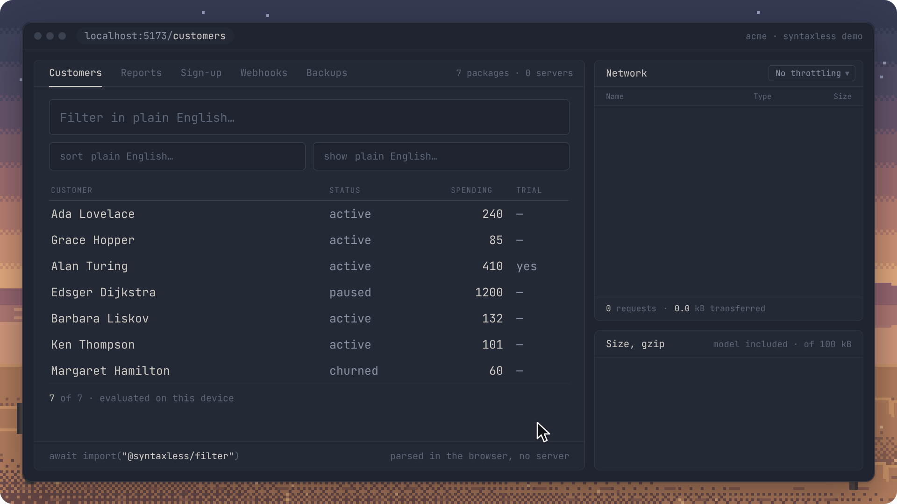

<h1 align="center">
  <picture>
    <source media="(prefers-color-scheme: dark)" srcset="docs/media/logo/logo-dark.svg" />
    
  </picture>
</h1>

<p align="center">
  Syntaxless turns plain English into cron expressions, SQL filters, validation rules, and more.<br />
  The packages work in TypeScript and JavaScript, with no API calls or runtime dependencies.
</p>

<p align="center">
  <a href="https://github.com/berezovyy/syntaxless/actions/workflows/ci.yml"></a>
  <a href="LICENSE"></a>
  
  
</p>

<p align="center">
  
</p>

Each package parses one kind of English instruction with a small model included
in the package. A successful parse returns a typed intent, which is a JavaScript object
containing the requested settings. You can save or edit the intent, then compile
it into the output your app needs.

Parsing runs locally, and no input is sent to a server. Each package is under
100 kB after gzip compression, including its model. The packages use ES modules
and run in Node.js 18 or newer, Bun, and modern browsers. The model loads on the
first parse, and parsing works offline once the package is available locally.

Compilation uses ordinary code, and the same intent and options produce the
same output. When the parser detects conflicting instructions, unsupported
wording, or a prediction below its confidence threshold, it returns an error
code and a reason. Each package's evaluation documentation describes its
measured accuracy and known limitations.

## Packages

Choose a package for the kind of instruction your app accepts. Sizes include
the entire built package and its model, compressed with `gzip -9`.

| Package                                                   | Example input                                       | Output                                                             | Size, gzip |
| --------------------------------------------------------- | --------------------------------------------------- | ------------------------------------------------------------------ | ---------- |
| [`@syntaxless/cron`](packages/cron/README.md)             | `weekdays at 9:30am`                                | Cron expression `30 9 * * 1-5` and next occurrences                | 92.6 kB    |
| [`@syntaxless/validation`](packages/validation/README.md) | `required email with max 100 characters`            | JSON Schema                                                        | 75.5 kB    |
| [`@syntaxless/filter`](packages/filter/README.md)         | `active customers spending over 100`                | SQLite `WHERE` with parameters and a JavaScript predicate          | 36.1 kB    |
| [`@syntaxless/sort`](packages/sort/README.md)             | `newest first, then cheapest`                       | SQLite `ORDER BY` and a JavaScript comparator                      | 35.0 kB    |
| [`@syntaxless/retry`](packages/retry/README.md)           | `retry three times, start at 250ms, double it`      | Retry delays with exponential backoff                              | 35.9 kB    |
| [`@syntaxless/retention`](packages/retention/README.md)   | `keep daily backups for a week, monthly for a year` | A preview of which backups to keep or remove                       | 35.7 kB    |
| [`@syntaxless/format`](packages/format/README.md)         | `euros, two decimals, negatives in parentheses`     | An `Intl` formatter for numbers, currencies, percentages, or dates | 37.5 kB    |

## Quick start

Install the packages you need. For example, install `cron` to parse recurring
schedules and `format` to parse formatting instructions:

```sh
npm install @syntaxless/cron @syntaxless/format
```

The `cron` function parses and compiles a schedule in one call. For formatting,
call `parse` to get the intent, then pass the intent and a locale to `compile`:

```ts
import { cron } from "@syntaxless/cron";
import { compile, parse } from "@syntaxless/format";

await cron("every monday at 5pm");
// { supported: true, expression: "0 17 * * 1", intent: { … } }

await cron("remind me tomorrow at 3");
// { supported: false, code: "unsafe-context",
//   reason: "the text does not request a recurring schedule", intent: null }

const parsed = await parse("euros, two decimals, negatives in parentheses");
if (parsed.ok) {
  const compiled = compile(parsed.intent, { locale: "en-US" });
  if (compiled.supported) compiled.formatter.format(-1234.5);
  // { supported: true, text: "(€1,234.50)" }
}
```

## How it works

The model labels parts of the input, and the remaining code builds and compiles
the intent. For example, the cron parser identifies the days and time in
`weekdays at 9:30am` before compiling the schedule to `30 9 * * 1-5`.

<p align="center">
  
</p>

1. First, the tokenizer splits the input into tokens and calculates a fixed set
   of features for each token.
2. Second, the model assigns each token a role and a confidence score. The model
   stores its weights as 6-bit integers in generated TypeScript.
3. Third, the resolver builds a typed intent from the token roles. It checks for
   conflicts, unsupported wording, and predictions below the confidence threshold.
4. Fourth, the compiler validates the intent and produces the package's output,
   such as a cron expression or SQL filter.

The models are trained on generated examples. Before a model can replace the
bundled version, it must pass the package's release checks, including an
evaluation on examples excluded from training and tuning. Each acceptance set
is used for one release evaluation, then retained for regression tests. Each
package's `evaluation/README.md` documents the procedure, results, and limitations.

## Usage examples

The demos below show package output from the displayed code, run with Bun.
Each package's README includes its API and supported inputs.

### Recurring schedules with [`@syntaxless/cron`](packages/cron/README.md)

The cron package compiles recurring schedules into cron expressions with five
fields and calculates the next occurrences. If cron can't represent a parsed
schedule, the result includes an error and preserves the intent. You can use
the intent to calculate occurrences separately.

<p align="center">
  
</p>

### Form validation with [`@syntaxless/validation`](packages/validation/README.md)

The validation package parses field requirements into a typed intent and
compiles the intent into JSON Schema. You can use it to define rules for form
fields, such as a required email address with a maximum length.

<p align="center">
  
</p>

### Data filtering with [`@syntaxless/filter`](packages/filter/README.md)

The filter package compiles conditions into a JavaScript predicate, which tests
whether a record matches the conditions. You can also compile the intent into
a SQLite `WHERE` fragment with separate query parameters.

<p align="center">
  
</p>

### Data sorting with [`@syntaxless/sort`](packages/sort/README.md)

The sort package parses instructions into sort keys and directions. It compiles
the intent into a JavaScript comparator for sorting arrays or a SQLite
`ORDER BY` fragment for database queries.

<p align="center">
  
</p>

### Retry policies with [`@syntaxless/retry`](packages/retry/README.md)

The retry package calculates delays from instructions about retry counts,
initial delays, and delay limits. The package returns errors for missing required
values unless you supply defaults in the options.

<p align="center">
  
</p>

### Backup retention with [`@syntaxless/retention`](packages/retention/README.md)

The retention package parses backup retention rules and previews which backups
to keep or remove. Your app controls deletion, and the package doesn't delete
any backups.

<p align="center">
  
</p>

### Number and date formatting with [`@syntaxless/format`](packages/format/README.md)

The format package compiles formatting instructions into validated `Intl`
formatters for numbers, currencies, percentages, and dates. Supply a locale to
control regional formatting, and supply a time zone for dates and times.

<p align="center">
  
</p>

## Development

Development requires Bun 1.4.3 or newer. Training and Python tests also require
Python 3.13 and [uv](https://docs.astral.sh/uv/).

The formatting scripts use the Bun canary version pinned in `package.json`
because the project uses `bun fmt`. The scripts fetch the pinned version with
`bunx`, so you can run them from a stable Bun installation.

You can also use `nix develop` or `direnv allow` to load the environment defined
in [flake.nix](flake.nix). It provides the pinned Bun canary, Node.js 22,
Python 3.13, and uv on Linux and Apple Silicon macOS.

First, install the workspace dependencies:

```sh
bun install --frozen-lockfile
```

Second, run the checks for formatting, linting, types, TypeScript tests, and
builds, including package size limits:

```sh
bun run check
```

To format the source files and documentation, run `bun run format`. You can run
each check separately with `bun run format:check`, `bun run lint`,
`bun run typecheck`, `bun run test`, or `bun run build`.

After building a package, check its packed archive in Bun and Node.js and test
it offline in Chromium. For example, run the format package's checks from the
repository root:

```sh
bun run --cwd packages/format check:package
bun run --cwd packages/format test:browser
```

The browser check requires Playwright's Chromium. See [TESTING.md](TESTING.md)
for setup instructions, test coverage, and review requirements.

For Python tests, first install the Python dependencies, then run the suites:

```sh
uv sync --project training/cron --locked
bun run test:python
```

See [CONTRIBUTING.md](CONTRIBUTING.md) for contribution instructions.

<details>
<summary>Repository layout</summary>

The published packages live under `packages/`, alongside their training code
and evaluation data.

```text
packages/<package>/            Package source, tests, and build scripts
packages/<package>/training/   TypeScript code for data generation, evaluation, and release checks
packages/<package>/evaluation/ Evaluation sets, usage records, and procedures
packages/shared/              TypeScript code shared by the packages and training tools
training/cron/                Python training and export code for cron, and the shared uv environment
training/shared/              Python training and export code for the other packages
training/validation/          Python export code for validation thresholds
scripts/                      Shared build and package checks
docs/media/                   README images, videos, and their source files
```

</details>

## Training

Run a package's training command from the repository root:

```sh
bun run train:cron
bun run train:validation
```

The other packages use the same command pattern, such as `bun run train:filter`
or `bun run train:format`. Each package's `training/README.md` describes its
inputs, outputs, and settings.

The training command writes a candidate model to a new run directory. First,
it generates training examples. Second, it trains and exports the candidate.
Third, it evaluates the candidate without replacing the bundled model.
Replacing the bundled model requires a separate run of the package's release
checks.

Git ignores generated training data, run directories, caches, and build outputs.
Use the training commands to regenerate model files, and don't edit generated
model files or reserved evaluation data by hand.

## License

Syntaxless is available under the [MIT License](LICENSE).
