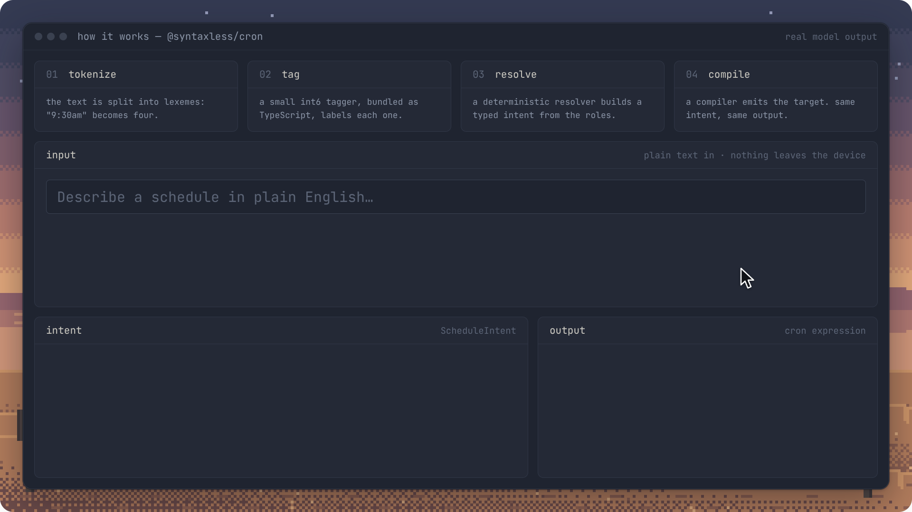
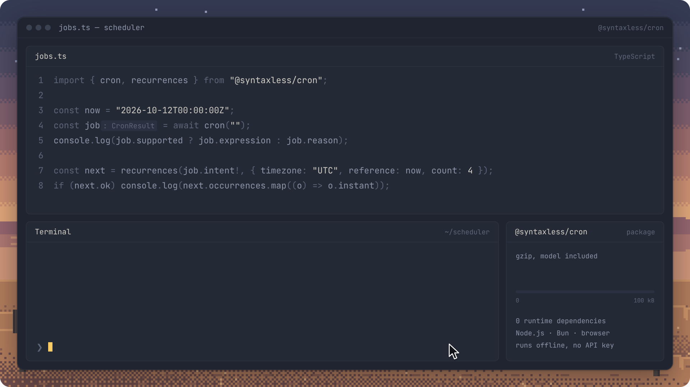
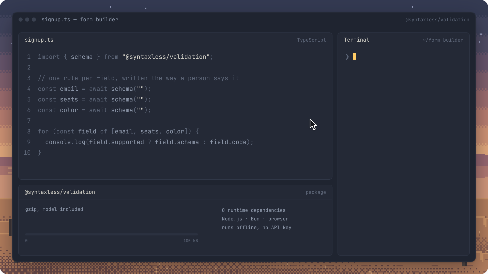
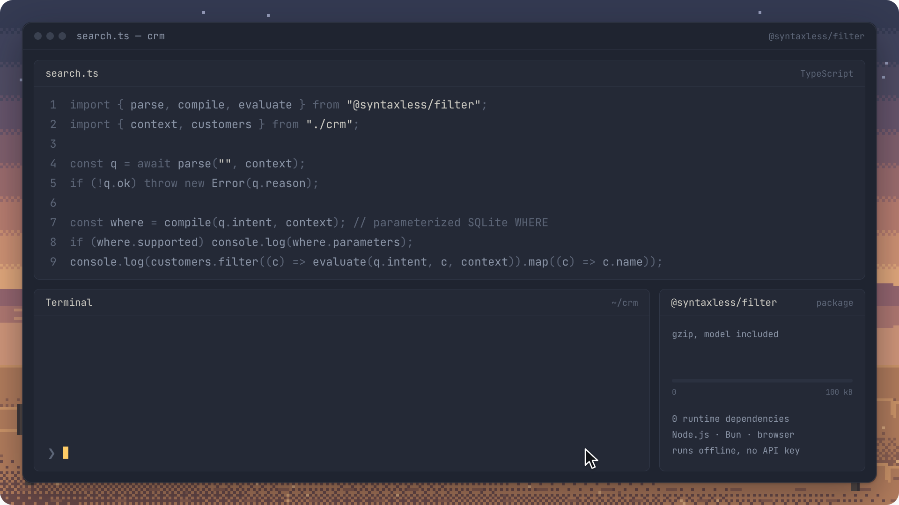
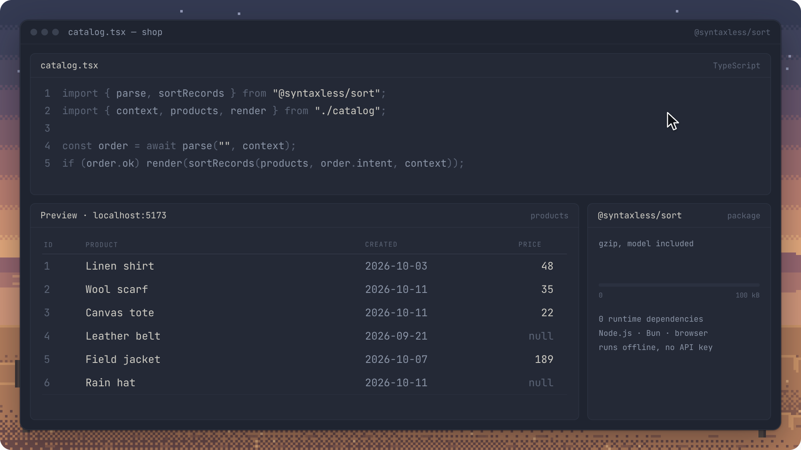
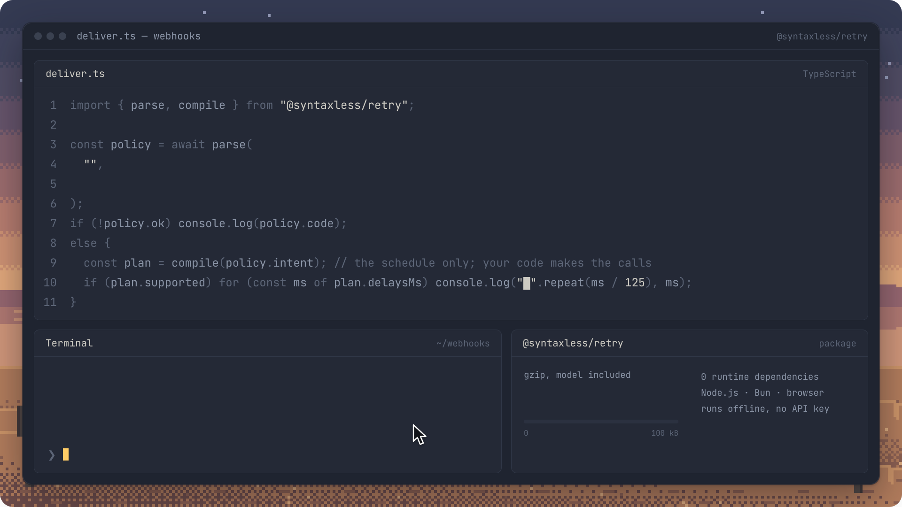
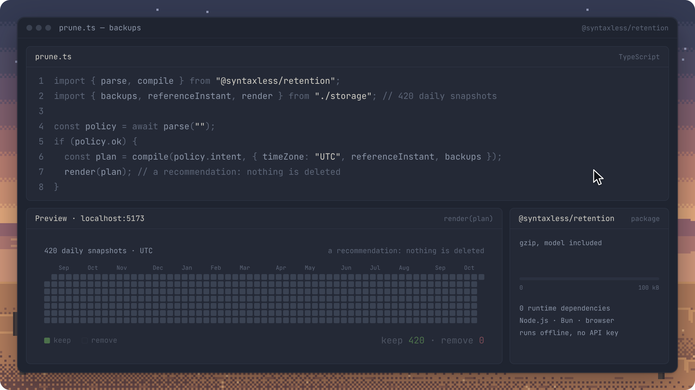
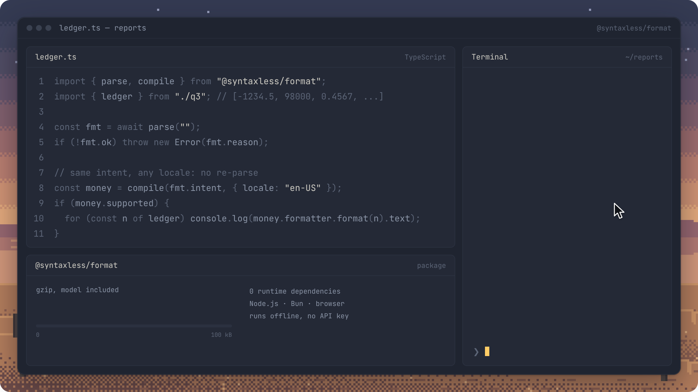

<h1 align="center">
  <picture>
    <source media="(prefers-color-scheme: dark)" srcset="docs/media/logo/logo-dark.svg" />
    
  </picture>
</h1>

<p align="center">
  <strong>Plain English in. Typed, deterministic output out.</strong><br />
  Small natural-language parsers for TypeScript and JavaScript that run on the device and refuse instead of guessing.
</p>

<p align="center">
  <a href="https://github.com/berezovyy/syntaxless/actions/workflows/ci.yml"></a>
  <a href="LICENSE"></a>
  
  
</p>

<p align="center">
  
</p>

Each Syntaxless package turns one kind of English instruction into a typed,
editable intent with a small bundled model, then compiles that intent with
ordinary, deterministic code. Nothing is sent to a server. When a package can't
interpret the input safely, it returns a failure with a code and a reason
instead of guessing.

- **Small.** Each package is under 100 kB gzip with its model included;
  `@syntaxless/filter` is 36.1 kB.
- **Local.** The model ships inside the package, loads lazily and runs in
  Node.js, Bun and the browser, offline. No API keys, no server, no runtime
  dependencies.
- **Typed.** Every parse returns a typed intent: plain data you can store, show,
  edit and compile again without re-parsing the text.
- **Deterministic.** The same intent always compiles to the same output.
- **Honest.** Unsupported wording, conflicts and low-confidence predictions come
  back as failures with a code and a reason your UI can act on.

## Quick start

```sh
npm install @syntaxless/cron @syntaxless/format
```

```ts
import { cron } from "@syntaxless/cron";
import { compile, parse } from "@syntaxless/format";

await cron("every monday at 5pm");
// { supported: true, expression: "0 17 * * 1", intent: { … } }

await cron("remind me tomorrow at 3");
// { supported: false, code: "unsafe-context",
//   reason: "the text does not request a recurring schedule", intent: null }

const parsed = await parse("euros, two decimals, negatives in parentheses");
if (parsed.ok) {
  const compiled = compile(parsed.intent, { locale: "en-US" });
  if (compiled.supported) compiled.formatter.format(-1234.5);
  // { supported: true, text: "(€1,234.50)" }
}
```

## How it works

<p align="center">
  
</p>

1. **Tokenize.** A tokenizer splits the text into lexemes with fixed features.
2. **Tag.** A small int6-quantized tagger, shipped as generated TypeScript,
   labels each lexeme with a role and a confidence.
3. **Resolve.** A deterministic resolver builds a typed intent from the roles. It
   refuses conflicts, unsupported wording and low-confidence predictions.
4. **Compile.** A compiler turns the intent into the target output: a cron
   expression, JSON Schema, a SQL fragment, a delay schedule, an `Intl`
   formatter and so on.

Models are trained on generated corpora. A model is promoted only through a
release gate that runs one-shot, reserved evaluation sets. Each package's
`evaluation/README.md` documents its protocol, results and limitations.

## Where to use it

Every value on screen is the package's real output for the code shown, run
with Bun.

### [`@syntaxless/cron`](packages/cron/README.md): schedule fields

Recurring schedules to 5-field cron expressions, plus the next occurrences.
When cron can't express a schedule, it says so and keeps the intent.

<p align="center">
  
</p>

### [`@syntaxless/validation`](packages/validation/README.md): form builders

Field constraints to a typed intent and JSON Schema.

<p align="center">
  
</p>

### [`@syntaxless/filter`](packages/filter/README.md): search over your data

Predicates you can evaluate in JavaScript or compile to parameterized SQLite
`WHERE` fragments.

<p align="center">
  
</p>

### [`@syntaxless/sort`](packages/sort/README.md): ordering lists and tables

Sort keys, a JavaScript comparator and SQLite `ORDER BY` fragments.

<p align="center">
  
</p>

### [`@syntaxless/retry`](packages/retry/README.md): retry policies

Retry policies to deterministic, bounded delay schedules. It never invents a
missing value.

<p align="center">
  
</p>

### [`@syntaxless/retention`](packages/retention/README.md): backup retention

Retention policies to keep/remove previews. It recommends; it never deletes.

<p align="center">
  
</p>

### [`@syntaxless/format`](packages/format/README.md): number and date formats

Number, currency, percentage and date/time formats as validated `Intl`
formatters.

<p align="center">
  
</p>

## Packages

| Package                                                   | Turns text into                                                                   | Size, gzip |
| --------------------------------------------------------- | --------------------------------------------------------------------------------- | ---------- |
| [`@syntaxless/cron`](packages/cron/README.md)             | Recurring schedules and 5-field cron expressions                                  | 92.6 kB    |
| [`@syntaxless/validation`](packages/validation/README.md) | Field constraints and JSON Schema                                                 | 75.5 kB    |
| [`@syntaxless/filter`](packages/filter/README.md)         | Predicates, a JavaScript matcher and parameterized SQLite `WHERE` fragments       | 36.1 kB    |
| [`@syntaxless/sort`](packages/sort/README.md)             | Sort keys, a JavaScript comparator and SQLite `ORDER BY` fragments                | 35.0 kB    |
| [`@syntaxless/retry`](packages/retry/README.md)           | Retry policies and deterministic, bounded delay schedules                         | 35.9 kB    |
| [`@syntaxless/retention`](packages/retention/README.md)   | Backup retention policies and keep/remove previews                                | 35.7 kB    |
| [`@syntaxless/format`](packages/format/README.md)         | Number, currency, percentage and date/time formats as validated `Intl` formatters | 37.5 kB    |

All packages are ESM-only, have no runtime dependencies, and run in Node.js 18+,
Bun and modern browsers. The model loads lazily on first use. Sizes are the
whole built package, model included, at `gzip -9`.

## Development

Requirements: Bun 1.4 or newer. Python training also needs Python 3.13 and
[uv](https://docs.astral.sh/uv/).

```sh
bun install --frozen-lockfile
bun run check          # formatting, type checking, TypeScript tests and builds with size gates
bun run format         # format sources and docs
```

The checks also run individually: `bun run format:check`, `bun run typecheck`,
`bun run test` and `bun run build`. Package-level checks run from each package
directory, for example:

```sh
bun run --cwd packages/format check:package   # packed tarball in Bun and Node consumers
bun run --cwd packages/format test:browser    # offline Chromium check (needs Playwright's Chromium)
```

Python tests:

```sh
uv sync --project training/cron --locked
bun run test:python
```

See [TESTING.md](TESTING.md) for what the tests cover and the review standard,
and [CONTRIBUTING.md](CONTRIBUTING.md) for the contribution workflow.

<details>
<summary><strong>Repository layout</strong></summary>

```
packages/<package>/            published runtime: src/, tests/, scripts/ (build, size, package and browser checks)
packages/<package>/training/   private TypeScript workspace: corpus, featurization, evaluation and release gate
packages/<package>/evaluation/ reserved evaluation sets, consumption records and protocol
packages/shared/               private TypeScript shared by the runtimes (model decoding, inference, tokenizer)
                               and by training (JSONL, binary shards, reserved-wording checks, statistics)
training/cron/                 Python training and export harness for cron, and the shared uv environment
training/shared/               Python training and export harness for the other six packages
training/validation/           validation's boundary-calibrating exporter
scripts/                       build helpers shared by every package (declarations, tarball check)
docs/media/                    README media: logo/ holds the logo and its generator, v3/ the films and their HyperFrames sources
```

</details>

## Training

Each package has one coordinator command, run from the repository root:

```sh
bun run train:cron
bun run train:validation   # also: train:filter, train:sort, train:retry, train:retention, train:format
```

A coordinator generates a fresh corpus, then trains, exports and evaluates a
candidate in a new run directory. It never changes the bundled model; promotion
requires the package's full release gate. See each package's
`training/README.md` for inputs, outputs and the recipe.

Corpora, runs, caches and build outputs are ignored by Git. Regenerate them
through the training pipeline; never hand-edit generated model artifacts or
reserved evaluation data.

## License

[MIT](LICENSE)
